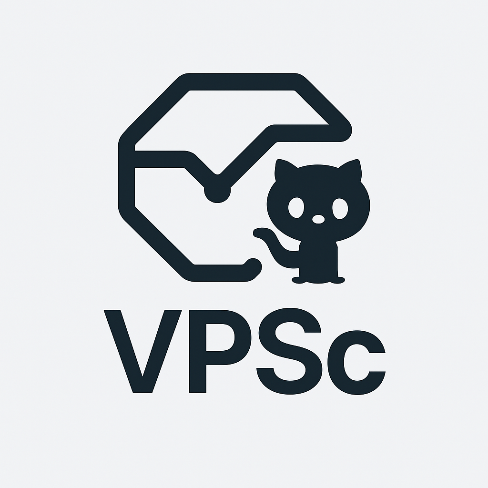
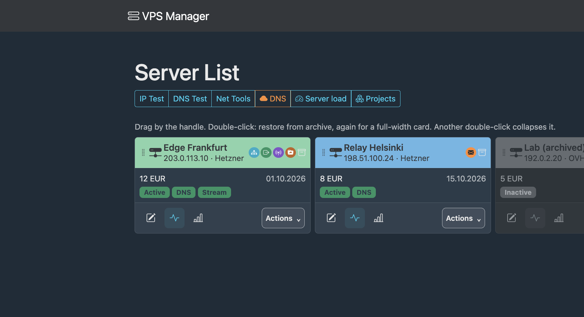
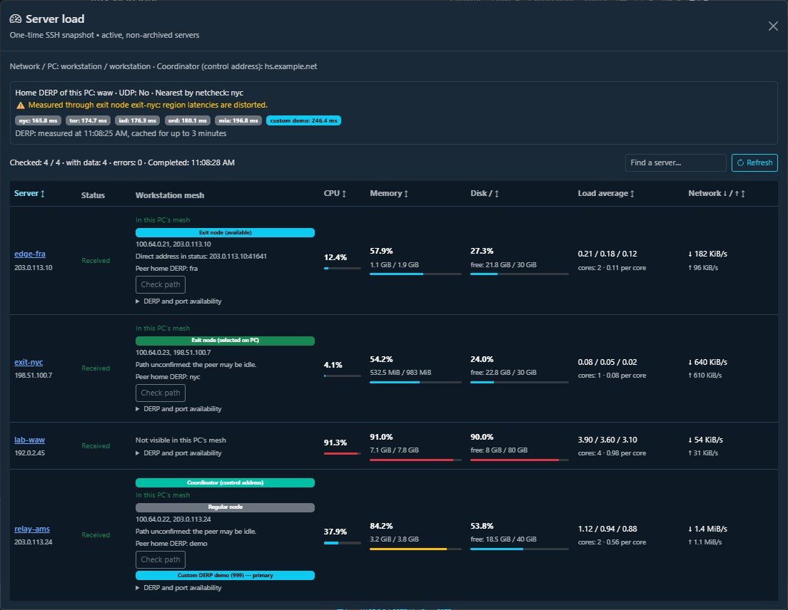
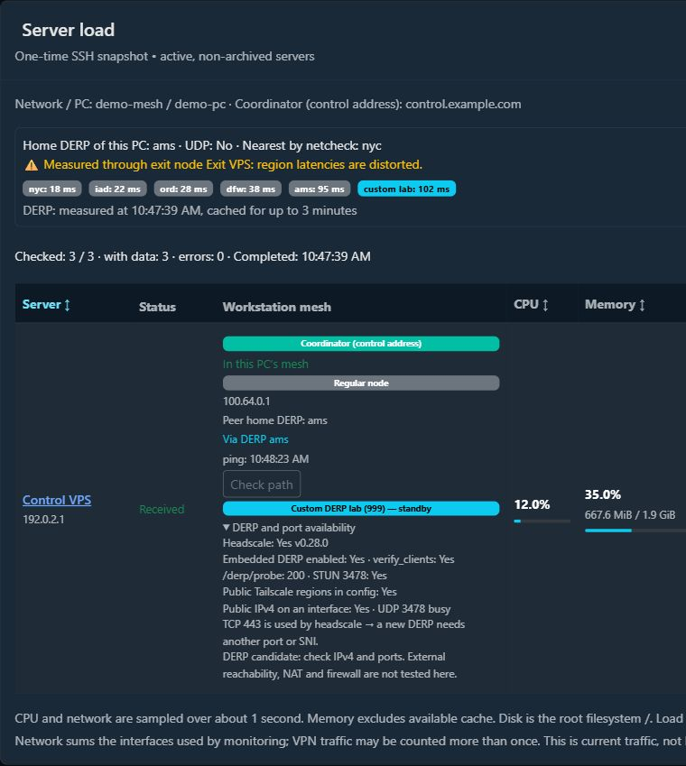

# VPN Server Manager v5.0.22

<p align="center">
  
</p>

<p align="center">
  <strong>A local SSH manager for your servers and homelab.</strong><br>
  Encrypted inventory · server checks · DNS · Tailscale and DERP diagnostics
</p>

<p align="center">
  <a href="https://github.com/kureinmaxim/vpn-server-manager/releases/latest"><strong>Download the published release</strong></a>
  &nbsp; · &nbsp; <a href="#quick-start"><strong>Run from source</strong></a>
  &nbsp; · &nbsp; <a href="CHANGELOG.md">Changelog</a>
</p>

<p align="center">
  <a href="https://github.com/kureinmaxim/vpn-server-manager/actions/workflows/ci.yml"></a>
  <a href="LICENSE"></a>
  <a href="#quick-start"></a>
  
</p>

VPN Server Manager keeps a personal server inventory, SSH credentials, domains, and provider details in a local encrypted vault. It runs as a desktop app or a local web server. It is designed for one operator, not a shared team control plane.

**What's new in development 5.0.22:** local macOS builds can opt into a private catalog seed, and the full transfer archive includes both saved lists. Standard/public builds stay empty-first so each user can enter their own projects and bots. This branch is not a signed macOS release; see the [changelog](CHANGELOG.md) and [verification notes](docs/SECURITY_FOUNDATION_5.0_ru.md).

## Three common workflows

1. **Add and check a server.** Save SSH access in a card, verify the server host key, then review status and load. [First server guide](docs/FIRST_SERVER_ru.md).
2. **Monitor a fleet or NAS.** Compare server load, inspect services, and check the app computer's Tailscale mesh and DERP path. [NAS guide](docs/NAS_SSH_SETUP_ru.md) · [platform limits](docs/SSH_OPERATIONS_MATRIX_ru.md).
3. **Maintain DNS and protect your data.** Keep domains and provider details in the local vault, run selected DNS checks, and export or restore a backup. [Backup and restore](docs/BACKUP_RESTORE_ru.md).

## Limits to know

- This is a server manager, not a VPN client or traffic tunnel.
- The vault is local and intended for one operator. There are no shared roles, approvals, or central audit trail. Do not use a shared drive as a team database.
- Remote features run over a direct SSH connection. The app does not provide an SSH jump host or cloud relay.
- Linux-only actions need supported remote tools and may need root or non-interactive `sudo -n`. Docker checks require access to Docker Engine; otherwise container state is reported as unknown.
- The published release and the development branch can have different platform packaging. The release page identifies available downloads.

## Quick start

### Published build

Open the [latest release](https://github.com/kureinmaxim/vpn-server-manager/releases/latest) and download its installer. Check the accompanying SHA-256 value before installing.

### Run from source

**Requires Python 3.13+.** The first launch creates a local profile and encryption key.

Windows:

```cmd
setup_windows.bat
start_windows.bat
```

Or install manually in PowerShell:

```powershell
git clone https://github.com/kureinmaxim/vpn-server-manager.git
cd vpn-server-manager
python -m venv venv
.\venv\Scripts\Activate.ps1
python -m pip install -r requirements.txt
copy env.example .env
python generate_key.py
copy config\config.json.template config.json
python run.py
```

macOS / Linux:

```bash
git clone https://github.com/kureinmaxim/vpn-server-manager.git
cd vpn-server-manager
python3 -m venv venv
source venv/bin/activate
python -m pip install -r requirements.txt
cp env.example .env
python3 generate_key.py
cp config/config.json.template config.json
python3 run.py
```

`python run.py --desktop` opens the native window when pywebview is installed. See the [build guide](BUILD.md) for packaging.

## Step-by-step guides

- [First server](docs/FIRST_SERVER_ru.md) — add a card, establish SSH host-key trust, run the first check.
- [NAS over SSH](docs/NAS_SSH_SETUP_ru.md) — enable SSH, choose account permissions, understand Docker/systemd limits.
- [SSH keys](docs/SSH_KEY_ru.md) — create a key, install its public part, save the private key or path in the card.
- [Backup and restore](docs/BACKUP_RESTORE_ru.md) — export, replace a profile, or merge servers into another installation.

## What you can monitor

| Area | Examples |
|---|---|
| **Server health** | CPU, memory, disk, network traffic, security events and systemd services over SSH. |
| **Network** | Tailscale membership, selected exit node, DERP latency and an explicitly requested peer-path check. |
| **Services** | Docker state when Docker Engine is reachable; optional user-defined Projects and Bots lists. |
| **DNS** | Providers, domains, records, renewal dates, imports and selected functional checks. |
| **Operations** | Supported service controls and protocol/client operations. Scope and required privileges vary by remote OS. |

Project and bot lists start empty. Add your own entries or import generic examples; configuration files are not inspected to populate them. See the [SSH support matrix](docs/SSH_OPERATIONS_MATRIX_ru.md) for OpenSSH import, operating systems, Docker and permissions.

<details>
<summary>Screenshots</summary>

<p align="center">
  
</p>
<p align="center">
  
</p>
<p align="center">
  
</p>

</details>

## Documentation and safety

- [Documentation index](docs/INDEX_ru.md) (Russian)
- [Monitoring guide](docs/README_MONITORING_ru.md) (Russian)
- [DNS card guide](docs/DNS_CARD_ru.md) (Russian)
- [Docker guide](docs/DOCKER_GUIDE_ru.md) (Russian)
- [Build guide](BUILD.md)
- [Terminal help](TERMINAL_HELP.md) · [Russian](TERMINAL_HELP_ru.md)
- [Changelog](CHANGELOG.md)

Change the default PIN before real use. Keep `.env` and exported backup files out of git and off shared drives. The encryption key is required to read a backup; there is no password recovery.

Questions: [Discussions](https://github.com/kureinmaxim/vpn-server-manager/discussions). Bugs: [Issues](https://github.com/kureinmaxim/vpn-server-manager/issues).

## License

[MIT](LICENSE)
