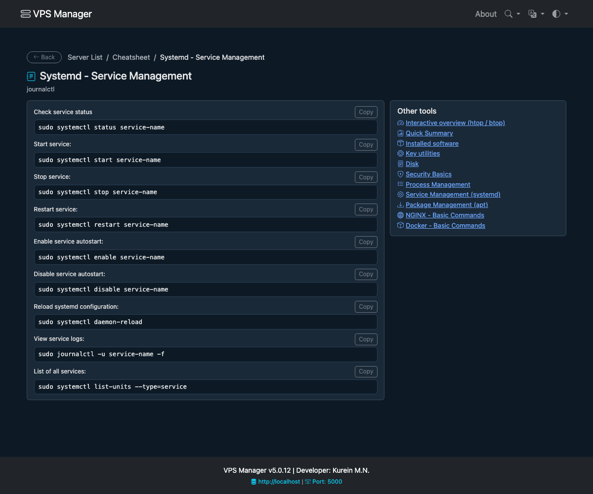
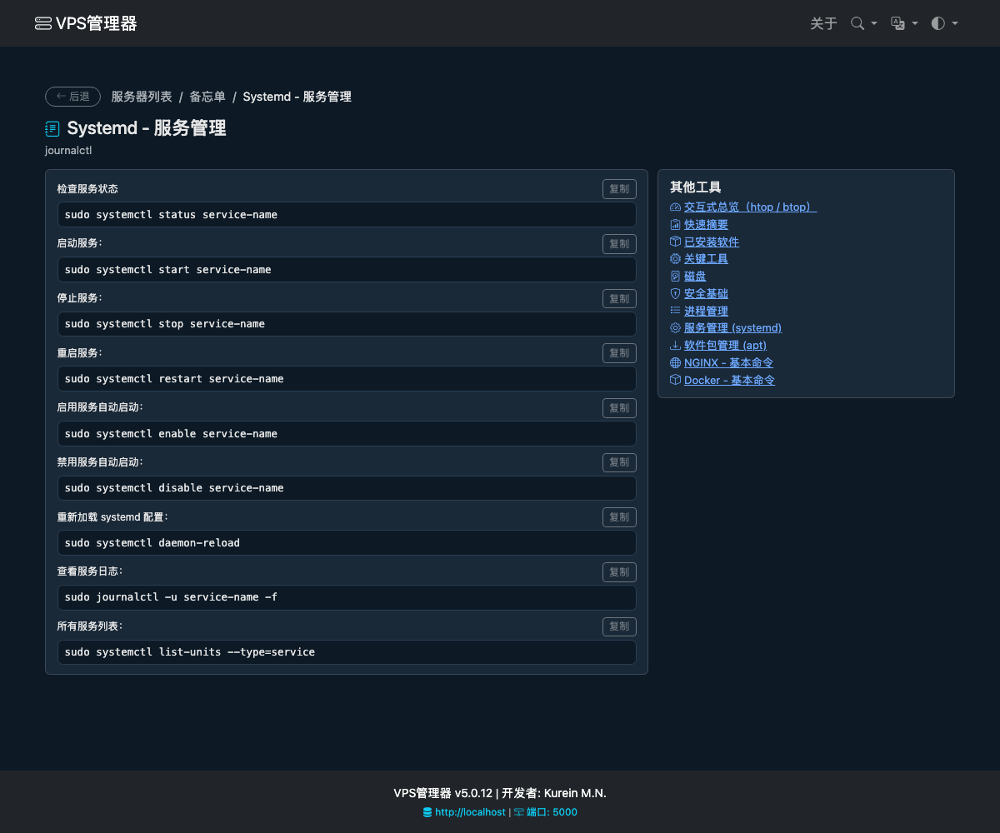
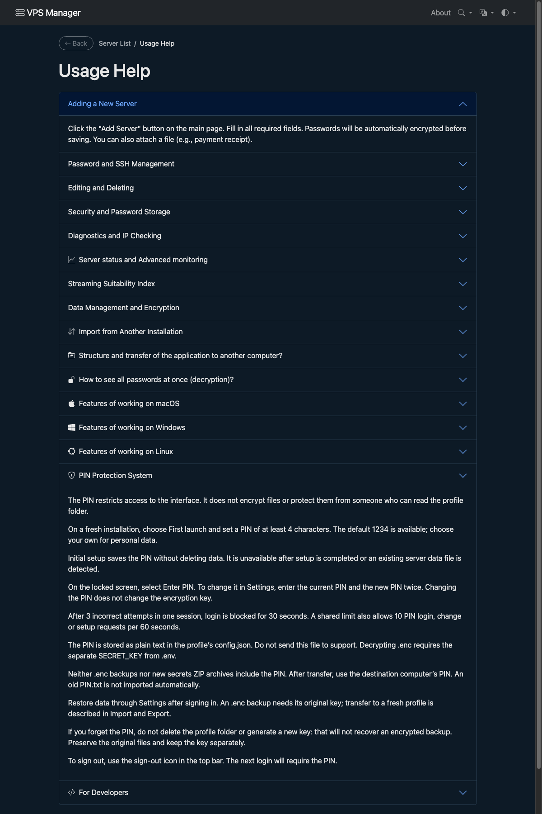
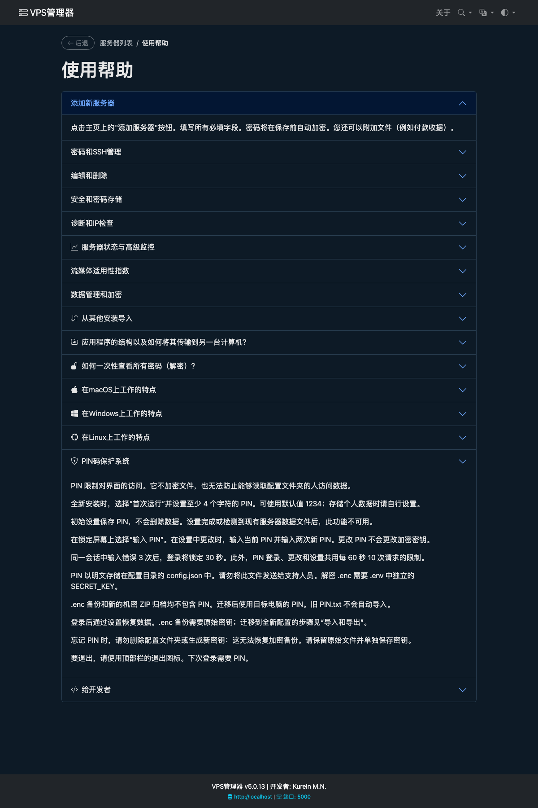

# UI terminology (ru / en / zh)

Reviewed vocabulary for translators. Preserve the operation and its object, not
just a similar-looking sentence. Russian msgids are the source language.

- Чек об оплате → payment receipt → 付款收据. Never check, hint, server, 支票 or 检查.
- Подсказка → hint → 提示. Keep distinct from receipts and data management.
- Ключ шифрования → encryption key → 加密密钥. SSH key is a separate credential.
- PIN → PIN → PIN. Never translate PIN as a physical pin (销钉/引脚). It locks the UI, not the vault encryption.
- Запустить → start → 启动; остановить → stop → 停止; перезапустить → restart → 重启.
- Включить автозапуск → enable autostart → 启用自动启动; отключить → disable → 禁用.
- Удалить → delete/remove → 删除. Name the object explicitly in confirmations.
- Сбросить → reset → 重置. Do not replace it with restart or delete.
- Перезагрузить конфигурацию → reload configuration → 重新加载配置. Keep distinct from restarting a service.
- Контейнер → container → 容器; пакет → package → 软件包; служба → service → 服务.

Before accepting changes, compare the translated action against its actual
command or route, including the affected object. Keep placeholders intact.
`tests/test_translation_examples.py` checks placeholders and selected reviewed
meanings; it cannot establish the quality of the whole catalog. Compile both
catalogs and inspect rendered pages. Historical README screenshots are not proof
of current translations. Current systemd previews were generated from the real
Flask template using a synthetic test session; no commands were executed.

Reviewed systemd page (5.0.12, synthetic session):

## PIN help and remaining-screen review (5.0.13)

PIN help was compared with `api.first_time_setup`, `api.login_ajax`,
`api.change_ajax`, `http_security.install` and the export implementation.
Corrected claims cover storage, non-destructive setup, rate limits, exports and
restore. Login and shared PIN dialogs now accept the longer PINs the server accepts.

Reviewed active-template translation collisions across navigation, server forms,
monitoring, settings, error pages and help. Reviewed action/confirmation labels in
cleanup, archive removal, service control, DNS, Net Tools and project/bot catalogs.
Corrected logout vs delete-server, uninstall-monitoring vs delete-hint, key vs
delete confirmation, retry vs repeat-key, home vs rotate-key and refresh vs offline.
Coverage scans check literal gettext strings; they do not prove dynamic messages
or every technical paragraph correct. This is not independent native-speaker QA.

The following snapshots render the real help template in a synthetic session with
the PIN section expanded. No real profile or remote commands are involved.

